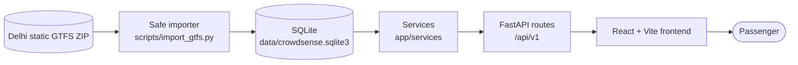
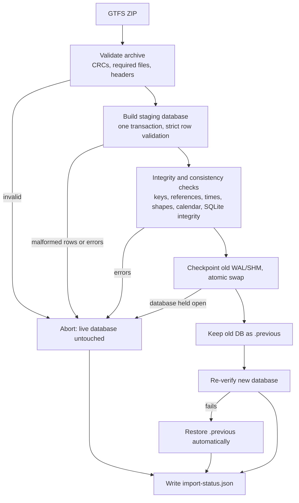

# CrowdSense

**Know the crowd before you board.**
A crowdedness-aware bus journey planner for Delhi.


---

## Table of contents

1. [What CrowdSense is](#what-crowdsense-is)
2. [Current scope and honesty statement](#current-scope-and-honesty-statement)
3. [Architecture and repository layout](#architecture-and-repository-layout)
4. [Prerequisites](#prerequisites)
5. [Quick start](#quick-start)
6. [Backend setup](#backend-setup)
7. [Environment configuration](#environment-configuration)
8. [Getting the GTFS data](#getting-the-gtfs-data)
9. [Importing GTFS (safe and repeatable)](#importing-gtfs-safe-and-repeatable)
10. [Database location](#database-location)
11. [Running the application](#running-the-application)
12. [Phase 4: maps, nearby stops, place clusters, smart search](#phase-4-maps-nearby-stops-place-clusters-smart-search)
13. [Health checks](#health-checks)
14. [Automated tests](#automated-tests)
15. [API summary](#api-summary-apiv1)
16. [Known limitations](#known-limitations)
17. [Documentation index](#documentation-index)
18. [Roadmap](#roadmap)

---

## What CrowdSense is

CrowdSense helps passengers choose a Delhi bus journey using more than the timetable. The long-term goal is to weigh
**travel time and expected crowd level together**, so a passenger can see how full a bus is likely to be before boarding.

The project is built in phases. This repository currently contains the **static-timetable foundation**: a validated GTFS
data layer, a read-only API on top of it, and a React frontend. The crowd-intelligence part of the vision depends on
data that has not been obtained yet (see below).

## Current scope and honesty statement

> **Current scope: Phase 1, the GTFS data engineering layer, built on the Phase 0 foundation, plus the Phase 4
> map/nearby/search additions described later in this file.**

| Capability | Status |
|---|---|
| Static GTFS import, validation and serving | Implemented |
| Stop, route, trip, shape and service queries | Implemented |
| Direct (single-bus), scheduled journey search | Implemented |
| Maps drawn from real GTFS shapes, nearby stops, place clusters, smart stop search | Implemented (Phase 4, see `docs/phase4/`) |
| Multi-transfer, schedule-aware routing | **Not implemented in the current version.** Planned as the next phase |
| Crowd / ETM (e-ticketing) data | **Not available.** Official records have not been obtained. Every journey reports `crowd.status = "NOT_AVAILABLE"` |
| Live vehicle tracking, delays, predictions | **Not implemented in the current version** |
| Crowd-aware ranking (fastest / less crowded / balanced) | **Planned / Roadmap** |

Nothing in the app is mocked or fabricated. Five different kinds of data must not be conflated: **static schedule,
actual operations, ticket data, historical load, and live crowd**. Only the first exists here. See
[docs/ARCHITECTURE.md](docs/ARCHITECTURE.md#five-different-kinds-of-data-do-not-conflate-them).

## Architecture and repository layout



```
backend/   FastAPI + SQLite (static GTFS)
  app/
    main.py            app factory, CORS, routers, lifespan (startup/shutdown logging)
    config.py          environment-driven, validated settings
    db.py              the only place SQLite connections are created
    api/               HTTP layer: routes, dependencies, error handlers
    services/          application logic: stops, network, shapes, summary, journeys, health
    gtfs/              spec (file/column definitions), archive validation, table-driven loader,
                       validation engine, service calendar, staged importer, schema
    schemas.py         Pydantic response models (API contract)
  scripts/import_gtfs.py       CLI for the safe importer
  scripts/benchmark_queries.py read-only query timing + query plans
  tests/                   pytest suite (synthetic GTFS fixtures, temp databases)
frontend/  React 19 + Vite 8 (src/config.js, src/api/, src/hooks/, src/components/) + Vitest
docs/                      ARCHITECTURE, GTFS_DATA_MODEL, GTFS_INGESTION, VALIDATION_RULES, API, PERFORMANCE
```

## Prerequisites

* Python 3.11+ (developed on 3.12)
* Node.js `^20.19` or `>=22.12` (required by Vite 8)
* The Delhi static GTFS ZIP (see [Getting the GTFS data](#getting-the-gtfs-data)). It is a data asset and is **not**
  committed to the repository.

## Quick start

Commands are shown for Windows PowerShell, which is what the project scripts target.

```powershell
# 1. Backend environment
cd backend
py -3.12 -m venv .venv
.\.venv\Scripts\Activate.ps1
pip install -r requirements-dev.txt

# 2. Put the GTFS ZIP at backend/data/delhi_buses_static_gtfs_v1.zip, then import and build derived data
python -m scripts.import_gtfs
python -m scripts.build_derived

# 3. Start the backend (http://127.0.0.1:8000, API docs at /docs)
python -m app

# 4. In a second terminal, start the frontend (http://localhost:5173)
cd frontend
npm ci
npm run dev
```

## Backend setup

```powershell
cd backend
py -3.12 -m venv .venv
.\.venv\Scripts\Activate.ps1
pip install -r requirements-dev.txt      # use requirements.txt for runtime only
Copy-Item .env.example .env              # optional; defaults work for local development
```

## Environment configuration

Backend settings live in `backend/.env` and are all optional.

| Variable | Default | Meaning |
|---|---|---|
| `APP_ENV` | `development` | `development`, `test` or `production` |
| `BACKEND_HOST` / `BACKEND_PORT` | `127.0.0.1` / `8000` | bind address for `python -m app` |
| `DATABASE_PATH` | `data/crowdsense.sqlite3` | SQLite file. Relative paths resolve against `backend/`, never the working directory |
| `GTFS_ZIP` | `data/delhi_buses_static_gtfs_v1.zip` | ZIP read by the importer |
| `CORS_ALLOWED_ORIGINS` | the two Vite dev origins | comma-separated origins; **required** (no `*`) in production |
| `LOG_LEVEL` | `INFO` | `DEBUG` to `CRITICAL` |

Invalid configuration stops the application at startup with a message listing every problem. Real environment variables
override `.env`.

Frontend: `frontend/.env.example` documents `VITE_API_BASE_URL` (default `http://127.0.0.1:8000/api/v1`).
`VITE_MAP_STYLE_URL` optionally enables a street basemap (see [Phase 4](#phase-4-maps-nearby-stops-place-clusters-smart-search)).

## Getting the GTFS data

Place the Delhi static GTFS ZIP at `backend/data/delhi_buses_static_gtfs_v1.zip`, or point `GTFS_ZIP` elsewhere. Files
may sit at the ZIP root or inside a single nested folder; both are detected.

The importer reads every GTFS Schedule file it supports:

* Core: `agency`, `stops`, `routes`, `trips`, `stop_times`, `calendar`, `calendar_dates`, `shapes`, `feed_info`
* Also, when present: `frequencies`, `transfers`, `levels`, `pathways`, `attributions`, `fare_attributes`, `fare_rules`

Optional files that are absent are reported; nothing is invented.

## Importing GTFS (safe and repeatable)

```powershell
cd backend
python -m scripts.import_gtfs                  # import GTFS_ZIP into DATABASE_PATH
python -m scripts.import_gtfs --validate-only  # full validation; the database is never touched
```



How it protects your data:

1. The ZIP is validated first: CRCs, required files, the header of every supported file. Both calendar files absent means reject.
2. A **new staging database** (`<db>.staging`) is built in one transaction with strict validation of every row. Malformed
   rows are *reported with file and line number, never silently dropped*; any problem aborts the import.
3. Duplicate keys, referential integrity, schedule consistency (times, sequences, shape distances), calendar and shape
   checks, and SQLite integrity are verified before commit. Findings are **errors** (abort), **warnings** and **info**;
   see `docs/VALIDATION_RULES.md`.
4. Only then is the live database replaced (atomic rename). The WAL/SHM sidecars of the old database are checkpointed
   away first so stale frames can never be applied to the new file. If the database is held open (Windows refuses to
   replace open files) the import waits briefly, then fails safely, leaving the old database untouched.
5. The replaced database is kept as `<db>.previous` (one generation). After the swap the new file is re-verified; if
   that fails, the previous database is restored automatically.
6. A **failed import never modifies the live database.** Re-importing never creates duplicates, because each import is a
   fresh build.
7. The outcome of every attempt is written to `<db>.import-status.json` and surfaced by `/api/v1/health`. The
   **data-quality report** of the database being served is stored *inside* that database and exposed at
   `GET /api/v1/gtfs/validation-report`. Import status and data quality are separate things.

**Upgrading from Phase 0:** an existing database (schema v1) keeps serving the Phase 0 endpoints, but the new endpoints
answer `503 schema_outdated` until you run the import once. The old file is kept as `<db>.previous`.

**Exit codes:** `0` success, `1` import failed, `2` bad configuration. A leftover `<db>.import.lock` after a hard crash
can be deleted manually. For a guaranteed-quiet swap, stop the API during import; this is not required.

## Database location

`backend/data/crowdsense.sqlite3` by default (git-ignored), plus `*.previous` and `*.import-status.json`. SQLite is kept
for this phase. Future PostgreSQL migration notes are in `docs/ARCHITECTURE.md`.

## Running the application

```powershell
# terminal 1: backend (http://127.0.0.1:8000, API docs at /docs)
cd backend; .\.venv\Scripts\Activate.ps1; python -m app
#   development with reload:  uvicorn app.main:app --reload

# terminal 2: frontend (http://localhost:5173)
cd frontend; npm ci; npm run dev
```

The dev server binds to localhost only. Use `npm run dev -- --host` to expose it on your LAN.

## Phase 4: maps, nearby stops, place clusters, smart search

```powershell
cd backend; .\.venv\Scripts\Activate.ps1
python -m scripts.import_gtfs
python -m scripts.build_derived        # spatial index + place clusters + stop->routes. Run after EVERY import.
```

* Maps (journey details, route, stop, `/nearby`) draw **only real GTFS shapes**. If a trip has no shape, or a stop cannot
  be matched to it reliably, the page says so and shows the stops without a line.
* Set `VITE_MAP_STYLE_URL` to get a street basemap. There is no default provider by design; without it the map shows the
  route and stops on a plain background. Details, key restriction and privacy: `docs/phase4/OPERATIONS.md`.
* Your location is requested only after you press "Use my location", is never stored, and is redacted from server logs.
* Full evidence, decisions, API changes and known gaps: `docs/phase4/`.

## Health checks

| Endpoint | Purpose | Behaviour |
|---|---|---|
| `GET /api/v1/health/live` | Liveness | `200` whenever the process is up |
| `GET /api/v1/health` | Readiness | Reports `application`, `database`, `gtfs` and `crowd_engine` separately |

Readiness returns **200 only if the database is reachable and GTFS data is loaded**. Otherwise it returns **503** with
`status` set to `needs_setup` (missing or empty data: run the import) or `error`. `crowd_engine` is always
`not_connected` for now. Responses never contain file paths or raw exception text.

## Automated tests

```powershell
cd backend;  python -m pytest -q                       # temp databases + synthetic GTFS only
cd backend;  $env:CROWDSENSE_REAL_FEED_ZIP="data\delhi_buses_static_gtfs_v1.zip"; python -m pytest -q -m real_feed   # optional, ~25 s, temp DB
cd backend;  python -m scripts.benchmark_queries --markdown   # timings + query plans on YOUR database (read-only)
cd frontend; npm test; npm run build
```

Or everything at once: `powershell -ExecutionPolicy Bypass -File scripts\verify.ps1`.

The test suite fails if the real `backend/data/crowdsense.sqlite3` is modified.

## API summary (`/api/v1`)

Errors use the shape `{"error": {"code", "message", "details?"}, "detail": "<message>"}`.

| Phase | Endpoints |
|---|---|
| Phase 0 | `GET /stops?q=&limit=` · `GET /journeys?origin_stop_id=&destination_stop_id=&departure=&limit=` · `GET /health` · `GET /health/live` |
| Phase 1 | `GET /agencies` · `/stops` (+`bbox`, `route_id`, `offset`) · `/stops/{id}` · `/stops/{id}/departures` · `/routes` · `/routes/{id}` · `/routes/{id}/trips` · `/routes/{id}/shapes` · `/trips/{id}` · `/trips/{id}/stop-times` · `/trips/{id}/shape` · `/shapes/{id}` · `/services/active` · `/gtfs/summary` · `/gtfs/validation-report` |
| Phase 4 (additive) | `GET /trips/{id}/shape?from_stop_id=&to_stop_id=` (leg geometry) · `/routes/{id}/shapes?geometry=true` · `GET /stops/nearby?lat=&lon=` · `GET /clusters/{id}` · `GET /stops?q=&mode=smart` |

Interactive docs are served at `/docs` when the backend is running. Full reference: `docs/API.md`. Phase 4 changes:
`docs/phase4/API_CHANGES.md`. Behaviour changes over time: `CHANGELOG.md`.

## Known limitations

* **Static GTFS only**: no crowd/ETM data, no live tracking, no delays. Scheduled departures are not predictions.
* **Routing is still direct trips only** (no transfers). The Phase 0 journey search does not include trips that started
  on the *previous* service day and run past midnight (`/stops/{id}/departures` does handle this).
* **Empty `arrival_time` / `departure_time` of non-timepoint stops are stored as NULL, not interpolated.** The Delhi feed
  has none.
* The importer is all-or-nothing: a feed with any malformed row or any validation *error* cannot be imported until fixed.
* **Not imported**: `translations.txt`, Fares v2 files, areas/networks/location groups/booking rules,
  `locations.geojson` (reported when present). Unknown columns are reported, not stored. Fields not covered by tests
  against a real feed (frequencies, transfers, pathways, levels, attributions, fares) are exercised by synthetic
  fixtures only; the Delhi feed contains none of them.
* **Delhi feed facts worth knowing**:
  * `feed_info.txt` has 2 rows (spec: 1).
  * 1,846 `stop_times` repeat the previous stop.
  * `trip_headsign`, `direction_id` and `block_id` are empty for every trip.
  * `stop_times.stop_dist` is empty, and `fare_stage` is a non-GTFS extension.
  * `calendar_dates.txt` is absent and there is a single weekly service (`1`, 2025-01-01 to 2040-01-01).
* Validation is not a GTFS-compliance certification (see `docs/VALIDATION_RULES.md`, "Not validated").
* The Phase 1 database is about 286 MB (Phase 0: about 193 MB) and the import takes about 30 s on the development machine.
* Promotion on a database that other processes hold open cannot be made atomic on every platform; it fails safely.
* No authentication or rate limiting. The API is read-only and intended to sit behind a trusted network or reverse proxy.

## Documentation index

| Document | Contents |
|---|---|
| [docs/ARCHITECTURE.md](docs/ARCHITECTURE.md) | System architecture, the five kinds of data, PostgreSQL migration notes |
| [docs/GTFS_DATA_MODEL.md](docs/GTFS_DATA_MODEL.md) | Stored GTFS entities and relationships |
| [docs/GTFS_INGESTION.md](docs/GTFS_INGESTION.md) | Importer workflow in detail |
| [docs/VALIDATION_RULES.md](docs/VALIDATION_RULES.md) | Errors, warnings, info, and what is not validated |
| [docs/API.md](docs/API.md) | Full API reference |
| [docs/PERFORMANCE.md](docs/PERFORMANCE.md) | Query timings and plans |
| [docs/phase4/](docs/phase4/) | Maps, nearby stops, clusters, smart search: evidence, operations, API changes |
| [CHANGELOG.md](CHANGELOG.md) | Behaviour changes |

## Roadmap

1. **Schedule-aware multi-transfer routing** on top of the current GTFS data layer. This is the next phase.
2. **Crowd data pipeline** (depends on obtaining official ETM/e-ticketing records): trip and stop matching, passenger
   load reconstruction, segment-level occupancy, historical crowd profiles.
3. **Crowd-aware recommendations**: fastest, less crowded and balanced journey options.
4. **Live operations data**, only if a trustworthy source becomes available.

Items 2 to 4 are **Planned / Roadmap** and are **Not implemented in the current version.**